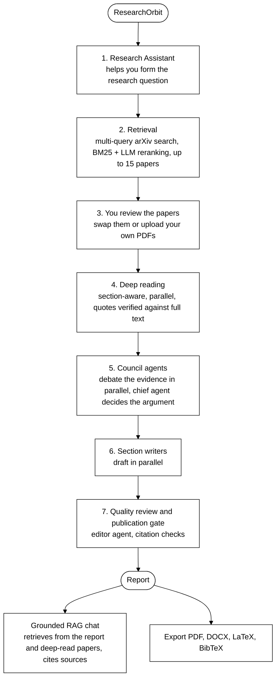

# ResearchOrbit

ResearchOrbit is an AI research assistant. It takes you from a rough idea to a cited research report: it helps you form the question, retrieves and deep-reads the relevant papers, has a team of agents analyse them, writes the report, checks its quality, and then lets you chat with the report and the papers behind it.

I designed and built the whole system end to end: retrieval, multi-agent orchestration, a FastAPI backend, and a Next.js frontend.

**Live app:** [researchorbit.vercel.app](https://researchorbit.vercel.app/)

> **Please read before using the app**
>
> ResearchOrbit uses my free Groq API key by default, so it is slower than it could be and may sometimes stop working.
>
> - **Why it is slow:** every step makes model requests, and the free tier limits how many can run at once. Rate limits are the bottleneck, so I can't run multiple requests in parallel the way the pipeline is designed to. Paper retrieval can take up to 5-6 minutes. Reading the papers thoroughly, preparing the report, and grounding the report and papers into the chat can take another 8-10 minutes.
> - **Why it may stop working:** the key can hit its usage limit. If that happens, wait a while and open the site again later, or type your question again.
> - **What you can do instead:** enter your own API key in the app and run the analysis with it. Your key is used only for your requests. It is never stored in the browser (no local storage or cookies) and never shown in logs.

The source code is not published here. This repository documents the project.

## Problems it solves

| Problem with AI research tools | How ResearchOrbit solves it |
| --- | --- |
| A vague question gives a vague report. | A Research Assistant helps you shape the question and decide what you want to find out before any search runs. |
| Models sound confident while inventing quotes. | Every quote must match the paper's full text exactly, or it is dropped. |
| Citations point to things that don't exist. | A final gate checks every citation against the evidence that was retrieved. Failures are repaired or removed. |
| Abstracts alone give shallow answers. | Papers are deep-read section by section, in parallel, using only the parts that carry evidence. |
| One model pass gives one-sided conclusions. | Multiple council agents review the same evidence from different angles, then a chief agent decides the argument. |
| Chatbots answer from memory and can be wrong. | The chat is grounded in your report and the deep-read papers, and shows where every answer came from. |
| Weak or irrelevant papers pad the results. | Up to 15 relevant papers are kept. If fewer are relevant, you get fewer. |
| Reports read like summaries, not analysis. | Council agents and a review agent check the report for synthesis quality, overclaiming, and gaps before you see it. |

## How it works

1. **Form the question.** Tell the Research Assistant what you are curious about. It helps you narrow it into a clear question and work out what you actually want to find out.
2. **Find.** Several query variations search arXiv, and the best papers are ranked and kept.
3. **Review.** You can swap papers or upload your own. Papers you lock in are never silently replaced.
4. **Read.** Each paper is split into sections. Only the evidence-bearing parts go to the model. References are never sent.
5. **Debate.** Four council agents (evidence skeptic, methodologist, mechanism analyst, gap finder) and one independent synthesis agent read the same evidence at once. A chief agent decides the argument.
6. **Write.** Writers draft sections in parallel.
7. **Check.** A final gate verifies every citation before the report is shown.

## Report types and report quality

**Report types:** standard report, literature review, state of the art, gap analysis, comparison, evidence review, research proposal, paper analysis.

The report type changes how papers are read. A gap analysis focuses on limitations and failures, while a comparison focuses on datasets, baselines and metrics.

Quality is built in at several points, by council agents before writing and by review agents after:

- **Council agents** challenge the evidence: what was actually demonstrated versus only claimed, whether comparisons between papers are fair, how the methods really work, and which limitations point to open research gaps.
- **Automatic checks** measure how many paragraphs are cited, how many paragraphs combine several papers, and whether every selected paper is actually used. They also catch internal system language leaking into the text.
- **A review agent acts as a journal editor.** It flags overstated claims, findings that were never integrated, repeated sections, weak transitions, and paper-by-paper summaries pretending to be synthesis. Problems are then fixed.
- **The publication gate** verifies every citation last.

Each report states what is established, what is not, and where the research gaps are, so you can see how strong the evidence is.

## Chat grounded in the report and the deep-read papers

When the report is ready, your research becomes something you can talk to and ask anything about. The chat is grounded in the generated report and in every deep-read paper: its reading notes, verified quotes, and passages from the full text. You can ask about them directly and keep asking follow-ups:

- About the report: its conclusions, how two findings relate, where the research gaps are.
- About one paper: its method, datasets, results, limitations, or why it was selected.
- For explanations: "explain this paper in simple terms" or "why do these two papers disagree?"
- For exact details, taken from the paper's own text instead of the model's memory.

To keep answers trustworthy:

- It answers only from the report and papers.
- Sentences with numbers that are not in that material are removed.
- Every answer shows where it came from: the paper, the section, and the exact excerpt.
- If the material does not contain the answer, it says so instead of guessing.

## Engineering

**AI engineering**
- Retrieval-augmented generation in two places: hybrid paper retrieval (query planning, BM25, LLM reranking with a deterministic fallback) and a grounded chat that retrieves passages from the report and the full paper text.
- Multi-agent orchestration with LangGraph: council agents, a chief agent, parallel section writers, and review agents.
- Grounding checks in code: exact quote matching, citation validation, and removal of unsupported numbers.
- Prompt-injection defense for text inside papers, and honest disclosure when a paper cannot be read.
- Works with Groq, OpenAI, Anthropic, Google and Mistral, with a token scheduler that waits on rate limits and a recovery path for empty or malformed responses.

**Backend**
- FastAPI background jobs with streamed progress, cancellation, saved report versions, and re-analysis when papers are added.
- PDF upload handling, report export to PDF, DOCX, LaTeX and BibTeX, and Docker and nginx deployment.

**Frontend**
- Next.js and React workspace with live stage-by-stage progress, a stop button, a resizable chat panel, and report downloads.

**Quality**
- 126 offline test modules, an end-to-end evaluation harness, and CI that builds and tests on every push.

## Future improvements

- Make the whole pipeline much faster, ideally close to instant, by moving to a paid LLM tier with higher rate limits.
- Run much more of the reading and writing in parallel. The pipeline is already built for it, but the free tier's rate limits currently force requests to run one after another.
- Let users choose between faster and deeper analysis.

## License

MIT

